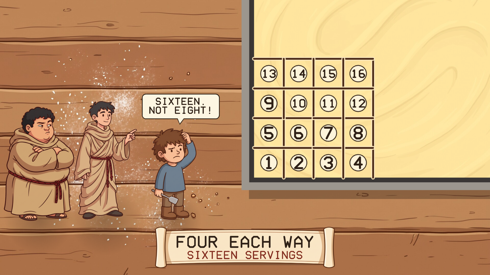
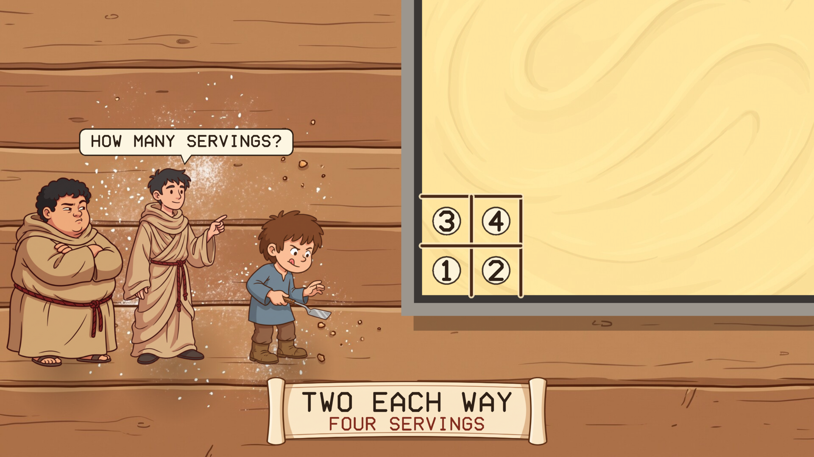
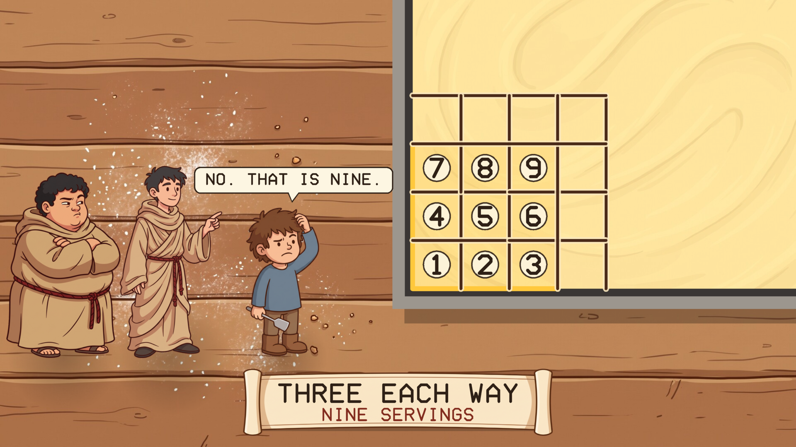
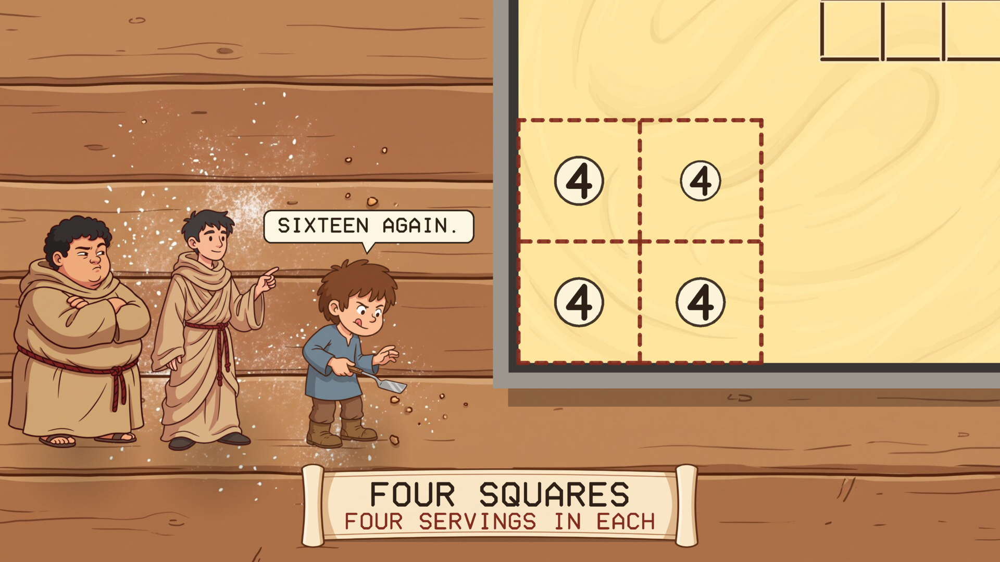
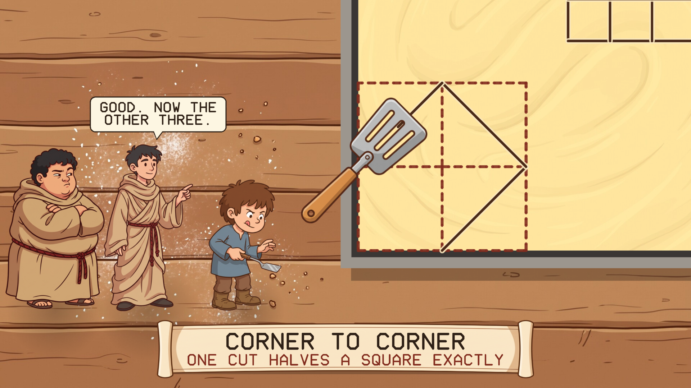
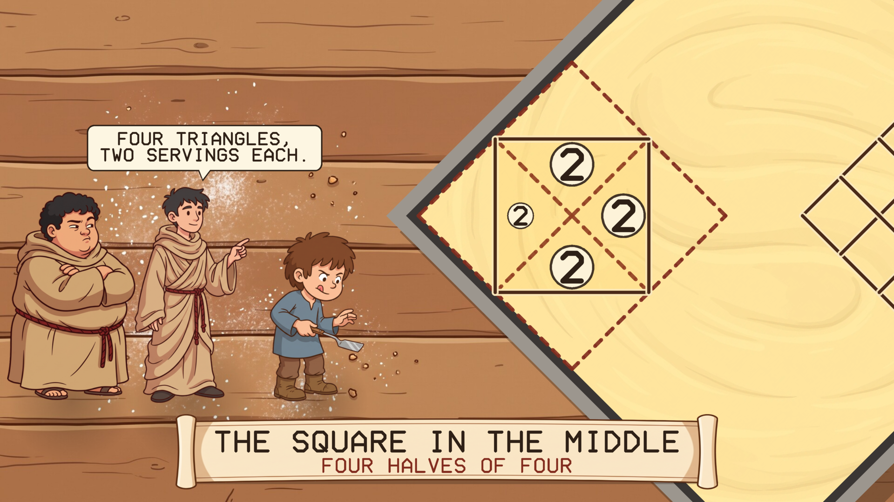
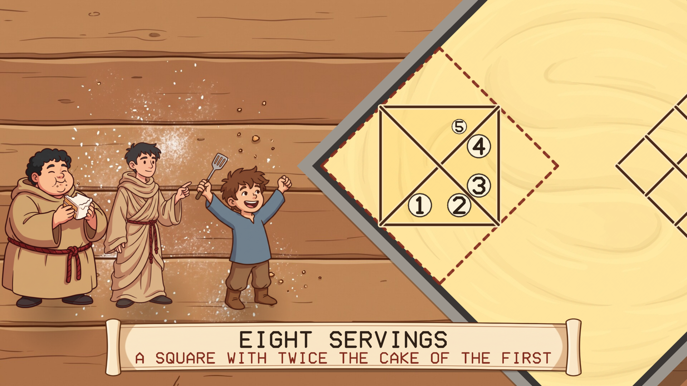
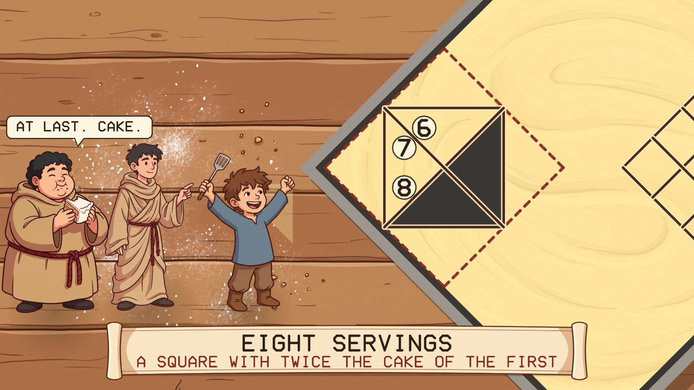

# Cutting the Cake

A screensaver of Calca 1 from Neal Stephenson's novel *Anathem*. Linux and Windows.

In the first calca, Erasmas has a boy called Dath cut a cake, the way Thelenes once
taught a slave-boy on the Plane. Each serving is a square one spatula wide. Four
servings are easy. But a square twice as long each way gives sixteen, not eight,
and three each way gives nine. So how do you cut exactly eight?

It is the old problem of doubling the square, and the answer is to cut from corner
to corner.

## What it shows

One lesson takes about a minute and a half, and then a new cake arrives with a
different icing.

| | |
|---|---|
|  |  |
| Two each way: four servings | Four each way: sixteen, not eight |
|  |  |
| Three each way: nine | A clean corner: four squares of four |
|  |  |
| One cut halves a square exactly | The square in the middle is four halves |
|  |  |
| Eight equal servings | Arsibalt gets his cake |

The steps follow the calca. The words in the speech bubbles are short lines of my
own, not the book's dialogue.

## Install

Packages are on the [releases page](../../releases).

### Windows

Run `CuttingTheCake-Setup-1.0.0.exe`. It asks for administrator rights, because
Windows only lists screensavers that are in its own system folder. After that
"Cutting the Cake" is in Screen Saver Settings with the others, already selected.
Uninstall from Apps.

### macOS

There are two downloads on the releases page, for Apple Silicon and Intel, macOS 11
or later.

**The screen saver** is the file ending `-mac-screensaver.zip`. Unzip it and
double-click the `.saver` file; macOS offers to install it. Then choose it in System
Settings, Screen Saver (scroll to the end of the list, under Other).

**The app** is the file ending `-mac.zip`: the same thing as an ordinary program
that runs full screen until you press a key.

Neither is signed with an Apple developer certificate, so macOS will refuse them at
first. After the refusal, open System Settings, Privacy & Security, scroll down,
and click Open Anyway. If the screen saver still will not load, clear the
quarantine mark in Terminal:

    xattr -dr com.apple.quarantine ~/Library/"Screen Savers"

Both are built on a Mac build machine, where the screen saver is loaded and made to
draw as a test. They have not yet been tried by a person on a real Mac, and screen
savers on recent macOS are known to be temperamental; reports are welcome.

### Linux

**Fedora, Nobara** (built on Fedora 44):

    sudo dnf install ./cutting-the-cake-1.0.0-1.fc44.x86_64.rpm

**Debian, Ubuntu, Mint** (Ubuntu 24.04 / Debian 13 or later):

    sudo apt install ./cutting-the-cake_1.0.0_amd64.deb

From your next login it starts by itself after five minutes idle, and any key or
mouse movement ends it. To start the watcher without logging out, or to change the
delay:

    cutting-the-cake-screensaver enable 10    # after 10 minutes idle
    cutting-the-cake-screensaver disable
    cutting-the-cake-screensaver status
    cutting-the-cake-screensaver now          # run it right away

Wayland desktops have no screensaver service to plug into, so the package starts a
small idle watcher (`swayidle`) at login. It works on compositors that provide the
ext-idle-notify protocol: KDE Plasma, Sway, Hyprland, niri, COSMIC, labwc and
others. GNOME does not provide it, and on X11 you would add `cutting-the-cake` to
xscreensaver or your desktop's own idle settings. It does not lock the screen. If
[Teglon](https://github.com/mottipython/teglon) or
[the Lazy Peregrin](https://github.com/mottipython/lazy-peregrin) is already on
screen it stays out of the way.

## Running it yourself

    cutting-the-cake              full screen on every display; any key or mouse movement quits
    cutting-the-cake --window     in a window; Esc or Q quits
    cutting-the-cake --speed 2    faster
    cutting-the-cake --snapshot out.bmp --time 63 --size 1920x1080

## Building

Needs a C compiler, make and SDL2 (2.0.18 or newer). Build from the top of the
source tree, because the pictures in `assets/art` are built into the program.

    make
    make check
    sudo make install

Packages are written to `dist/`. `tools/Containerfile` describes a container with
everything they need:

    podman build -t anathem-build -f tools/Containerfile tools
    podman run --rm --security-opt label=disable -v "$PWD":/src -w /src anathem-build make dist

## Credits and licence

MIT. *Anathem* and its calcas are Neal Stephenson's; this is an unofficial fan
project.

The pictures (Erasmas, Dath, Arsibalt, the spatula, the table, the icing and the
scroll) were drawn with Google Gemini and prepared by `tools/make_sprites.py`.
Images are decoded with [stb_image](https://github.com/nothings/stb) (public
domain).
